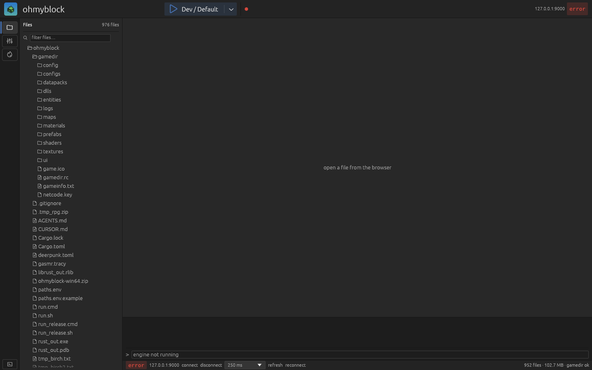
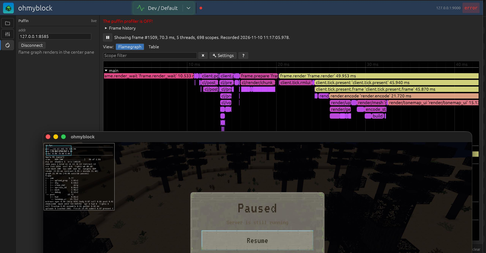
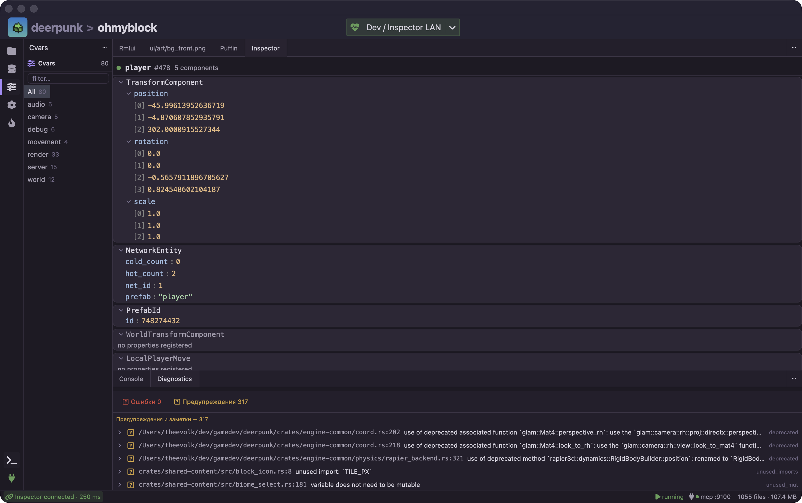

# deerpunk-studio

A native Rust desktop IDE (eframe/egui) for games built on the **deerpunk** engine (sibling repository). It wraps the whole edit → build → run → inspect loop in one window: open a game project, launch the engine with one click, and watch live inspector data, console output and profiling while the game runs.



## Features

- **Project model** — opens a game folder containing a `deerpunk.toml` (`[project]`, `[engine].gamedir`, `[engine].path`, `[launch].gamelibs`), parses `gameinfo.txt`, scans and indexes the gamedir assets.
- **Files view** — hierarchical file browser over the project root and gamedir, with tabbed text / image / binary viewers.
- **Cvars view** — browses the engine cvars catalog (`config/cvars_catalog.json`), grouped and filterable.
- **Live inspector** — JSON-RPC over WebSocket to the running engine's inspector server (default `127.0.0.1:9000`), auto-connects on project open; each collection gets its own tab in the left rail with list + detail panes and a configurable refresh interval.
- **Console** — bottom PTY panel with ANSI colors and stdin input, fed by the launch pipeline.
- **Launch profiles & scenarios** — `.deerpunk/profiles.toml` (build profiles, cargo features, env) and `.deerpunk/scenarios.toml` (extra engine CLI args), switchable from the toolbar.
- **Play button** — one-shot pipeline: build gamelibs → install them into the gamedir → build the engine → `cargo run … -- --gamedir … --svlib … --cllib …`, all output streamed to the console.
- **Puffin profiler** — live flame-graph view fed by the game's `puffin_http` server (default `:8585`), auto-connecting.

- **MCP for AI agents** — optional `deerpunk-mcp` companion server exposing the engine inspector collections over streamable HTTP (see below).
- Native macOS **File menu** (recent projects) via objc2.



## Build & run

```sh
cargo build --release
./target/release/deerpunk-studio /path/to/game-project
```

Tip: symlink the binary to `~/.cargo/bin/deerpunk-studio` so a fresh build is always the one on your `PATH`:

```sh
ln -sf "$PWD/target/release/deerpunk-studio" ~/.cargo/bin/deerpunk-studio
deerpunk-studio ~/dev/gamedev/ohmyblock
```

Launching from inside a game folder with no arguments opens that folder automatically (`deerpunk.toml` present), otherwise the last project. Passing `--run` starts the game instance immediately on open.

## Usage walkthrough

1. **Open a project** — pass the project folder on the command line, drop it onto the window, or use the File menu. The studio reads `deerpunk.toml` (engine path + gamedir), loads `gameinfo.txt` and scans assets in the background; the status bar shows the file count and whether the gamedir is valid.
2. **Press Play** — the toolbar Play button runs the pipeline (gamelibs → install → engine build → launch). Progress of each step and all engine output appear in the bottom console; you can type into the engine's stdin there.
3. **Inspect live state** — with the engine running, the inspector connection auto-connects (`127.0.0.1:9000` by default, configurable per scenario). Live collections appear as tabs in the left rail; pick a refresh interval in the status bar or refresh manually.
4. **Profile** — if the engine was launched with the `puffin` feature, the Puffin tab shows the live flame graph from `:8585`.
5. **Tune & relaunch** — switch launch profiles (debug/release, cargo features, env) and scenarios (extra engine args) from the toolbar; both live in `.deerpunk/` in the project folder.

## MCP for AI agents

The optional `deerpunk-mcp` crate (`crates/deerpunk-mcp`) ships an MCP server binary that exposes the engine's live inspector collections to AI agents over streamable HTTP:

- Endpoint: `http://<LAN-IP>:9100/mcp`
- `GET /status` — server/engine status probe
- Tools: `inspector_status`, `collections_list`, `collection_items`

The studio's left rail shows an MCP icon; clicking it opens a modal with the server status, the available tools, the machine's LAN IP, and instructions for connecting agents.

Generic MCP client config (point `url` at your machine's LAN address so agents on other devices can reach it):

```json
{
  "mcpServers": {
    "deerpunk": {
      "url": "http://192.168.1.20:9100/mcp"
    }
  }
}
```

Claude Desktop style:

```json
{
  "mcpServers": {
    "deerpunk": {
      "type": "http",
      "url": "http://192.168.1.20:9100/mcp"
    }
  }
}
```

## Development

```sh
cargo test        # 29 unit tests + headless snapshot tests
```

UI snapshots are rendered headless with [egui_kittest](https://crates.io/crates/egui_kittest) (wgpu, offscreen, retina 2x) via the example:

```sh
UPDATE_SNAPSHOTS=1 cargo run --example ui_snapshot -- /path/to/game-project [out.png]
# optional: --view <files|cvars|launch|puffin> before the output path
```

With `UPDATE_SNAPSHOTS=1` it writes `tests/snapshots/ui.png` and copies it to the given output path; without it, it renders and compares against the stored snapshot (used by the test suite). `docs/screens/*.png` are produced with this example.
