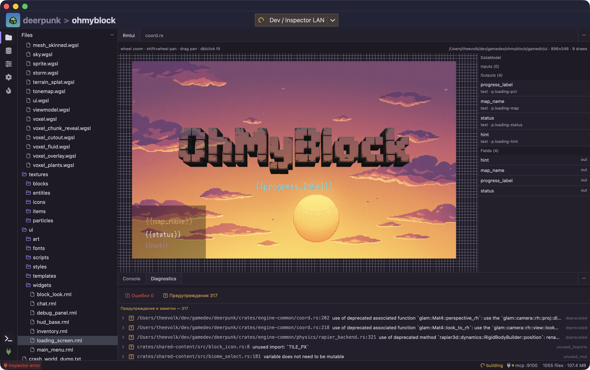
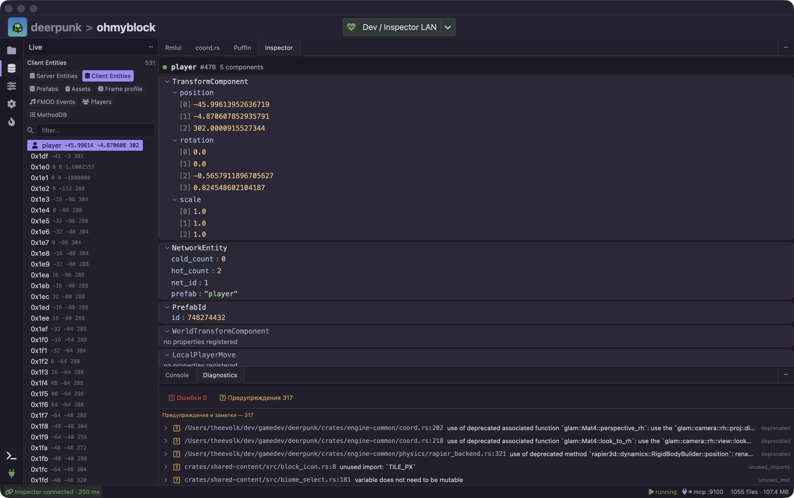
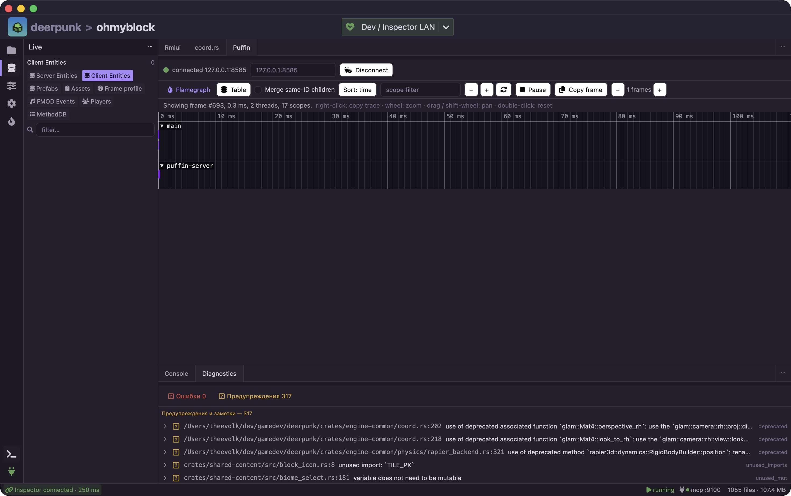
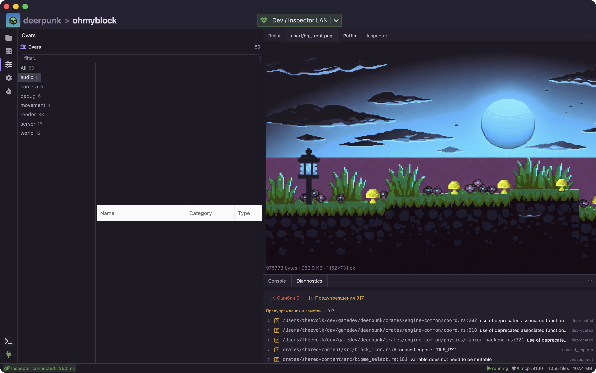

# 🦌 deerpunk-studio

A native Rust desktop IDE (GPUI) for games built on the **deerpunk** engine (sibling repository). One window wraps the whole edit → build → run → inspect loop: open a game project, launch the engine with one click, watch live inspector data, console output and profiling while the game runs.


## ✨ Features

- 📂 **Project model** — opens a game folder containing a `deerpunk.toml` (`[project]`, `[engine].gamedir`, `[engine].path`, `[launch].gamelibs`), parses `gameinfo.txt` and indexes the gamedir assets in the background.
- 🗂 **Files view** — hierarchical browser over the gamedir with tabbed asset viewers. Viewers come from a declarative registry (`register("ext=…/magic=…/bin=…", render)` — extension lists, hex magic prefixes, content sniff; first match wins) instead of `if ext == …` chains: text previews as monospace, textures decode in-app (png/jpg/bmp/tga/webp/… plus magic-byte matching for extensionless files), svg renders via the vector loader.
- 🎨 **RmlUi widget editor** — opening a `.rml` file summons a center-tab canvas: the engine's `deerpunk-ui` crate loads the document with the same `UiDirAssets` resolver as in-game (RCSS, `file://` textures, fonts, data-model templates) and the draw list is rasterized **on the GPU** via the engine's own wgpu `UiPass` (offscreen device, the game's `shaders/ui.wgsl`) — ~14× faster than the CPU path, with the in-app software rasterizer kept as fallback. The canvas has a grid background, wheel/pinch zoom to the cursor (0.1–8×), drag pan and double-click fit; a **DataModel panel** on the right lists the document's data-model fields.



- 📡 **Live inspector** — JSON-RPC over WebSocket to the running engine's inspector server (default `127.0.0.1:9000`), auto-connects on project open. Each collection gets its own tab in the left rail with a single-line filterable entity list; clicking an entity summons a shared **Inspector** center tab with the component/JSON detail. Refresh interval is configurable; live-detail and diagnostics lists are virtualized (~20×/~10× on large payloads).



- 📈 **Built-in Puffin profiler** — live flame-graph center tab fed by the game's puffin server (default `:8585`), auto-connecting; frame history, table view and scope filtering.



- ⚙️ **Cvars view** — browses the engine cvars catalog (`config/cvars_catalog.json`), grouped and filterable.


- 💬 **Console** — bottom PTY panel with ANSI colors and stdin input, fed by the launch pipeline.
- ▶️ **Play button** — one-shot pipeline: build gamelibs → install them into the gamedir → build the engine → run it with `--gamedir/--svlib/--cllib`, all output streamed to the console. Launch profiles and scenarios (`.deerpunk/profiles.toml`, `.deerpunk/scenarios.toml` — build profiles, cargo features, env, extra engine args) switch from the toolbar.
- 🖼 **Texture viewer** — textures from the gamedir open in a tabbed viewer with zoom; maps ship rendered previews.



- 🧠 **MCP for AI agents** — optional `deerpunk-mcp` companion server exposing the engine inspector collections over streamable HTTP (see 🧩 below).
- 🍎 **Native macOS File menu** (recent projects) via GPUI's native menu support (`App::set_menus`).

## 🤖 Agent tools

Headless helpers for layout iteration and AI agents — no window, no running engine:

```sh
# Render an RmlUi widget to PNG
deerpunk-studio shot path/to/gamedir/ui/widgets/loading_screen.rml --size 1280x720 -o loading.png
deerpunk-studio shot …/loading_screen.rml --state state.toml   # inject data-model fields

# Dump the post-layout component tree of a widget as indented text
deerpunk-studio tree …/inventory.rml
```

`shot --state` takes a flat TOML file (`title = "…"`, `progress = 0.7`, `visible = true`) injected into the document's `data-model` fields. The widget loads through the same `UiDirAssets` resolver as in-game (RCSS, `file://` textures, fonts), settles for a few frames, and the draw list is software-rasterized straight to a PNG — deliberately CPU-only for deterministic output without a GPU (the in-app live preview uses the GPU path). `tree` resolves the full RmlUi layout (boxes, templates, data-model expansion) and prints the resulting component tree as text.

## 🛠 Build & run

```sh
cargo build --release
./target/release/deerpunk-studio /path/to/game-project
```

The studio depends on the sibling engine checkout — `deerpunk-ui` / `deerpunk-engine-common` are path dependencies on `../deerpunk` (first build also compiles RmlUi via cmake, so it needs cmake + libclang).

Launching from inside a game folder with no arguments opens that folder automatically (`deerpunk.toml` present), otherwise the last project. Passing `--run` starts the game instance immediately on open.

## 🧩 MCP for AI agents

The optional `deerpunk-mcp` crate (`crates/deerpunk-mcp`) ships an MCP server binary that exposes the engine's live inspector collections to AI agents over streamable HTTP:

- Endpoint: `http://<LAN-IP>:9100/mcp`
- `GET /status` — server/engine status probe
- Tools: `inspector_status`, `collections_list`, `collection_items`

The studio's status bar shows an MCP chip; clicking it opens a modal with the server status, the available tools, the machine's LAN IP, and instructions for connecting agents.

Generic MCP client config (point `url` at your machine's LAN address so agents on other devices can reach it):

```json
{
  "mcpServers": {
    "deerpunk": {
      "url": "http://192.168.1.20:9100/mcp"
    }
  }
}
```

Claude Desktop style:

```json
{
  "mcpServers": {
    "deerpunk": {
      "type": "http",
      "url": "http://192.168.1.20:9100/mcp"
    }
  }
}
```

## 🔧 Development

Layout: this crate is the toolkit-agnostic core (project model, net protocol, PTY runner, asset scanning, `shot`/`tree` renderers); the GPUI frontend lives in `crates/studio-gpui` and produces the `deerpunk-studio` binary.

```sh
cargo test --workspace    # core unit tests + headless GPUI snapshot tests
```
